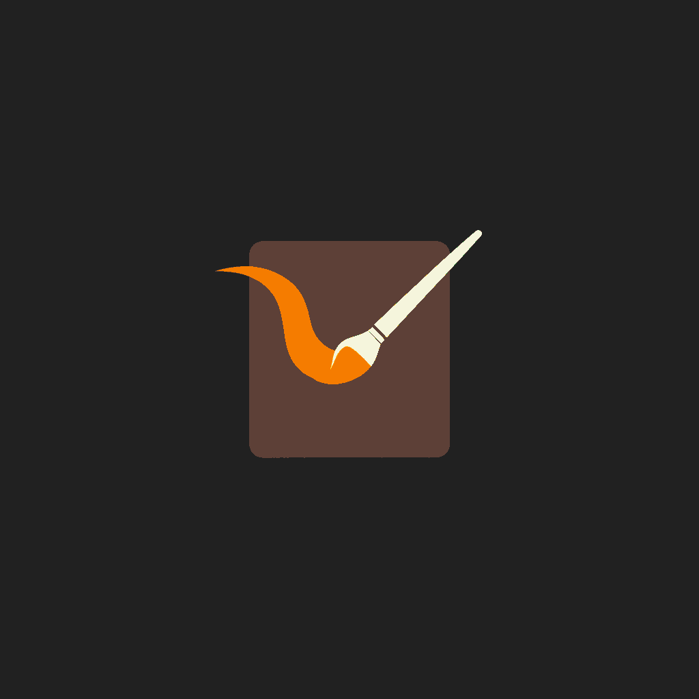

# Copywrite Me

*Part of [Jockkie Studio's](https://www.jockkie.com) open-source skills. I do the geeking. You get the easy part.*

> **Version 0.1.0, beta.** Tested in Claude; built to the specification of the other platforms but not yet tested there. See [Platform status](#platform-status), and please [report what you find](https://github.com/Jockkie/copywrite-me/issues/new/choose).

A copywriting skill for owners and makers who need a text that sells. It interviews you first, checks the current guidelines of your channel on the web, writes or rewrites the text, and scores it on a scorecard of up to 50 elements (opening, body, offer, close, proof, editing, channel fit) with a score out of 100, a visual before-and-after and concrete fixes.

Start by asking something like "write the landing page for my workshop" or paste a text and ask "why does this not convert?".

Optional tools, always with your consent, a quote and a spending cap: see [Optional tools](#optional-tools).

## Install

The skill folder is `skills/copywrite-me`.

**Claude Code (plugin)**
```
/plugin marketplace add Jockkie/copywrite-me
/plugin install copywrite-me@copywrite-me
```

**Claude.ai**
Download [`copywrite-me.zip`](https://github.com/Jockkie/copywrite-me/raw/main/dist/copywrite-me.zip) and upload it in Claude's skills settings.

**Hermes Agent (plugin)**
This repository is also a portable [Agent Plugins](https://vercel.com/kb/guide/agent-plugins) package (`plugin.json`, `skills/`, `mcp.json`), which Hermes loads natively. Copy the repository into `~/.hermes/plugins/copywrite-me`, then `hermes plugins enable copywrite-me`. Skill only: copy `skills/copywrite-me` into `~/.hermes/skills/`.

**ChatGPT (Business, Enterprise, Edu)**
Upload [`copywrite-me.zip`](https://github.com/Jockkie/copywrite-me/raw/main/dist/copywrite-me.zip) under Skills, Create, Upload.

**OpenClaw**
Copy `skills/copywrite-me` into `~/.openclaw/skills/` (or your workspace `skills/` folder) and start a new session.

**Grok**
Import [`copywrite-me.zip`](https://github.com/Jockkie/copywrite-me/raw/main/dist/copywrite-me.zip) under Skills. For Grok Build, copy the folder into `~/.grok/skills/`.

**Microsoft Copilot (Microsoft 365 Copilot, Premium)**
Download [`copywrite-me.zip`](https://github.com/Jockkie/copywrite-me/raw/main/dist/copywrite-me.zip), with `SKILL.md` at the root. In Microsoft Copilot open Home, right-click Agents and choose More agents, then Add, Upload skill, and pick the zip. Turn on "Let Copilot use this skill automatically", or choose the skill under Agents and Skills when you start. Copilot Cowork reads the same format: put the unzipped folder in your OneDrive skills folder (`Documents/Cowork/skills/`).

**GitHub Copilot (VS Code, Visual Studio, Copilot CLI, cloud agent)**
Copy `skills/copywrite-me` into `~/.copilot/skills/` for all your projects, or into `.github/skills/` in one repository.

**Codex, Cursor, Gemini CLI and other Agent Skills clients**
Copy `skills/copywrite-me` into the client's skills directory (for example `.agents/skills/`, `.cursor/skills/`, `~/.claude/skills/`).

## Platform status

| Platform | Status | What that means |
|----------|--------|-----------------|
| Claude Code | Validated | The marketplace, manifest and hook pass `claude plugin validate`; the skill was tested in evaluation rounds with Claude models |
| Claude.ai | Skill tested | The same `SKILL.md` as in the evaluations; the zip upload itself is not yet tested |
| Hermes Agent | Partially validated | The skill loads and `scripts/copy_score.py` runs in Hermes Agent 0.23.4; three real posts were scored with the scorecard on 28 November 2026. The interview flow and the guard hook are not yet exercised there, the hook is Claude Code only |
| Microsoft Copilot | Untested | Agent Skills upload (Premium). The interview and the method run; scripts only where Copilot runs code, and Monid and Flora are not connected there |
| GitHub Copilot | Untested | Built to the Agent Skills format; it runs code, so the scripts work there, as in Claude Code |
| ChatGPT, OpenClaw, Grok | Untested | Built to the Agent Skills format |
| Codex, Cursor, Gemini CLI and others | Untested | Built to the Agent Skills format |

The guard hook only runs in Claude Code. On other platforms, the visible self-check in the skill does that job. Tried it on an untested platform? [Tell us how it went](https://github.com/Jockkie/copywrite-me/issues/new/choose), whether it worked or not.

## Optional tools

Everything works without paid tools. Where they help, always with your consent, a quote and a spending cap you set:

- **[Monid](https://monid.ai?fpr=jockkie)**: public reviews and competitor pages, the words your readers already use. MCP: `https://mcp.monid.ai/v1`
- **[Flora](https://refer.flora.ai/jock-oosterveer-htu6)**: visuals that go with the text (carousel slides, post images, banners, ad variants). MCP: `https://mcp.flora.ai/mcp`
- **Jev** (TypeSafe): a second opinion on the scorecard

The Monid and Flora MCP servers do nothing until you authenticate them with `/mcp`.

**Disclosure:** the Flora and Monid links are affiliate links. Jockkie earns a commission when you create an account through them. The skill says so before it shares a link.

## How this skill keeps you from trusting a guess

AI tools sound sure of themselves, even when they are guessing. This skill is built to show you the difference:

1. **What you told me and what I assumed.** Every summary and every delivery separates what you said (with your own words), what the skill estimated (with its basis) and what is still unknown.
2. **A check before every step that matters.** Where the skill can run code, `check_dossier.py` or the skill's own script blocks the next step while a fact is labelled as yours without your words or a number has no label.
3. **A visible self-check** before every delivery: sources, invented numbers, one question at a time, files that really exist.
4. **In Claude Code, a guard.** A small hook sends a reply back for a fix when it asks several questions at once, contains an internal note, or claims a file was saved when none was written. It only acts in sessions where this skill is used.

A good habit with any AI advice: before you act on it, ask "Which of this did I tell you, and which did you assume?"

## Privacy

What you share stays with you. Personal data is never sent to external tools, and the files the skill makes are yours to keep. The skill asks for counts and roles, not names, and anonymizes exports first.

## Quality

Every change runs the script tests and checks on GitHub (`.github/workflows/tests.yml`). The skill itself is tested with written evaluation cases (`evals/evals.json`) and full simulated conversations, graded by a separate model; results are in `evals/results`.

**It is working if:** the score comes with the weak elements first and a fix per element; every number in the score is traceable to the scorecard reference; and nothing in the text is a claim you did not supply. If a score arrives without those three, the run failed, not the text.

What changed per version is in the [changelog](CHANGELOG.md). Want to help? Read [CONTRIBUTING](CONTRIBUTING.md). Found a security problem? Report it privately through the Security tab ([how](SECURITY.md)), not in a public issue.

## Credits

Eugene Schwartz's awareness levels and classic direct-response structure; scorecard by Jockkie Studio.

## The other skills

| Skill | For |
|-------|-----|
| [Consult Anything](https://github.com/Jockkie/consult-anything) | Owners and managers whose business is stuck |
| [Market This](https://github.com/Jockkie/market-this) | Owners and makers who need more customers |
| [Find My Ikigai](https://github.com/Jockkie/find-my-ikigai) | Anyone looking for what makes life worth living |
| [Align My Astro](https://github.com/Jockkie/align-my-astro) | Anyone who likes a daily reflection |

## Need a human?

The skill refers you to the right type of professional when a problem needs one. Jockkie Studio is one of the options: helicopter view, project management and workflows, process improvement, change and innovation, go-to-market, AI implementation.

## Contact and support

- Website: https://www.jockkie.com
- Email: info@jockkie.com
- The skill is free. If it helped you: https://buymeacoffee.com/jockkie

## License

MIT
